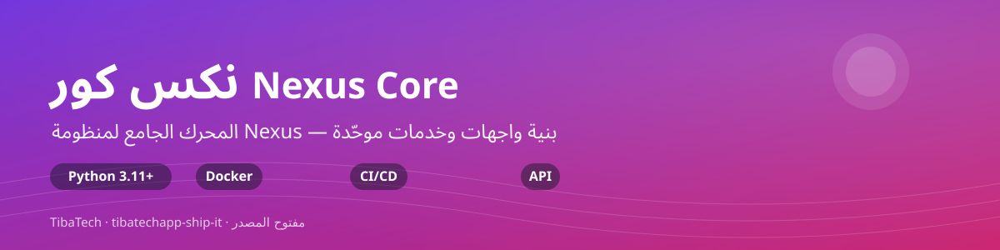

<p align="center">
  
</p>

# nexus-core — النظام الجامع للوكلاء

> **منصة وكلاء ذكاء اصطناعي كاملة تعمل على جهازك** — 106 وكيل، ذاكرة طويلة
> المدى، مجلس قرارات حيّ، ومنظومة أمن **MIZAN** بمحركات ستة. النواة
> **بايثون قياسي خالص (stdlib فقط)**: بلا اعتماديات تشغيل، تعمل حتى على
> هاتف، وقابلة للتدقيق سطراً بسطر — لا صندوق أسود.

**Unified AI Agent Platform: 106-Agent Fleet + Memory + Council + MIZAN Security Suite — self-hosted, auditable, stdlib-only core.**

[](https://github.com/tibatechapp-ship-it/nexus-core/actions/workflows/ci.yml)
[](https://github.com/tibatechapp-ship-it/nexus-core/actions/workflows/test.yml)
[](https://github.com/tibatechapp-ship-it/nexus-core/actions/workflows/mizan-scan.yml)
[](https://github.com/tibatechapp-ship-it/nexus-core/actions/workflows/test.yml)
[](LICENSE)
[](https://www.python.org/downloads/)
[](https://github.com/tibatechapp-ship-it/nexus-core/releases)

---

## ⚡ ما الذي يميّز هذا المشروع؟

| | nexus-core | المنصات المستضافة النمطية |
|---|---|---|
| **مكان التنفيذ** | جهازك — حتى هاتف (Termux) | سحابة المزوّد |
| **اعتماديات النواة** | **صفر** (stdlib فقط) | عشرات الحزم |
| **قابلية التدقيق** | كل قرار مقروء في الكود | صندوق أسود |
| **الأمن** | MIZAN: إصلاح تلقائي + Reachability + تلويث عبر الملفات + مرآة إعلانات + لوحة GRC + قواعد مخصصة — كلها `ast` خالص | غالباً خارجي/سحابي |
| **الإثبات** | **4,570 حالة اختبار** (4,541 ناجح / 29 متخطى) + 98 متجه هجوم معادي + بوابة تغطية ≥95% | — |

كل رقم في هذا الملف **قابل للتحقق محلياً** بأمر واحد: `make check`.

## 🧩 البدائيات الخمس — الواجهة الذهنية للمنصة

المنصة كلها تُشرح بخمس بدايات فقط — وكل ما تبقى يُبنى فوقها لا بجانبها:

| البداية | ما هي | من أين |
| --- | --- | --- |
| **وكيل** | وحدة عمل واحدة بدور محدود وسقف صلاحيات | `nova.registry` · **106** في الأسطول |
| **مجلس** | مداولة متعددة الأدوار بإجماع مُقاس (token-Jaccard، توقف مبكر ≥0.8) | `src.council.engine` |
| **منسّق** | توجيه مخاطر → توجيه وكيل → تفكيك → لجنة تحكيم | `src.orchestrator` |
| **ذاكرة** | تخزين دائم + استرجاع (RAG) عبر 4 متاجر SQLite (episodic/semantic/procedural/emotional) | `src.memory` |
| **سياج** | حواجز أمنية fail-closed تُرفض لا تُهمَّل | `src.security` · `src.durable` |

## 🛡️ منظومة MIZAN الأمنية — ستة محركات تغلق فجوات Snyk/Semgrep

مقارنة تنافسية مستقلة (نوفمبر 2026) رصدت ست فجوات بين MIZAN ومنصات
المؤسسات — **أُغلقت كلها في v1.59.0** بـ `ast` خالص، وبتجفيف افتراضي،
وبحدود معلنة بصراحة (الصراحة قبل الذكاء):

| المحرك | ما يفعله | الحد المعلن بصراحة |
|---|---|---|
| **س1 الإصلاح الحتمي** | خطط bump بأدنى إصدار مُصلح معلن، تجفيف افتراضي، workflow أسبوعي يفتح PR بأقل صلاحية | لا يخمّن إصدارات لم يعلن المصدر إصلاحاً لها |
| **س2 Reachability** | حكم ثلاثي لكل إعلان: `reachable` / `import-only` / `absent` — والإصلاحات تُرتّب لا تُحذف | استيراد مباشر فقط؛ الانتقالي قد يبقى غير مرئي |
| **س3 تلويث عبر الملفات** | مصدر→مصرف عبر الملفات بسلسلة مخيطة («a.py:2 input() → b.py:7 get() → c.py eval») | داخل المشروع؛ أسماء نصية؛ ميزانية خطوات معلنة |
| **س4 مرآة الإعلانات** | `sqlite3` من ملف واحد بـ SLA نضارة 24 ساعة معلن — فشل الشبكة يُعلن ولا يُفرّغ | لا قاعدة ملكية ولا zero-days — مصدر عام فقط |
| **س5 لوحة GRC** | HTML ساكن (RTL، صفر JS) يجمّع مستودعات عدة + خرائط ISO 27001/SOC 2/PCI DSS | «تغطية ضوابط مقترحة» — لا ادعاء شهادات |
| **س6 قواعد مخصصة** | DSL بصيغة JSON فوق `ast` (عقدة + نمط dotted + regex مسطح) + 7 قواعد مدمجة مُراجَعة | النطاق: المطابقة البسيطة — لا Semgrep كاملاً |

```bash
# خطّط إصلاحات الاعتماديات (تجفيف افتراضي — لا يكتب شيئاً)
python scripts/mizan/mizan_fix.py requirements.txt --advisories adv.json --reachability

# هل الكود يستدعي الحزمة المصابة فعلاً؟ (حكم ثلاثي)
python scripts/mizan/mizan_reach.py . --manifest requirements.txt

# تدفقات مصدر→مصرف عبر الملفات، بسلسلة مخيطة
python scripts/mizan/mizan_taint.py .

# مرآة إعلانات محلية بـ SLA نضارة (خروج 3 عند التقادم — جاهز لبوابات CI)
python scripts/mizan/mizan_mirror.py --db .mizan/adv.db sync --osv --manifest requirements.txt
python scripts/mizan/mizan_mirror.py --db .mizan/adv.db status --require-fresh

# لوحة حوكمة ساكنة من تقارير عدة مستودعات + خرائط الضوابط
python scripts/mizan/mizan_grc.py --report r1.json --report r2.json --out dashboard.html

# قواعدك المخصصة فوق ast
python scripts/mizan/mizan_rules.py check . --rules team-rules.json
```

156 اختبار انحدار لتغطية السلسلة (تغطية الحزمة **97%**) — الخارطة الكاملة
بالأحكام الصادقة: [`docs/MIZAN_ROADMAP.md`](docs/MIZAN_ROADMAP.md).

## 🔬 الطبقة الشكلية — «المُقترح يبحث، والحاكم يحكم»

إعادة هندسة عكسية للبنية المرجعية (AlphaProof / Lean 4 / TLA+ / Dafny /
CodeQL) إلى نواة stdlib — بصدق كامل حول الحدود:

| المستوى المرجعي | نكافئه بـ | الحد الصادق |
|---|---|---|
| TLA+ + TLC | فاحص نماذج محدود — متغيرات سلامة بأثر خالق كامل، استقرار محدود يُحترم الحلقات فيه | إثبات محدود بميزانية معلنة — لا غير محدود |
| Dafny (SMT) | فاحص عقود requires/ensures بسرد محدود على مجال معلن | لا SMT — مجالات صغيرة معلنة |
| Lean 4 kernel | عقد الحاكم: حكم ثلاثي حتمي، «تعذّر التحقق» معدٍ، لا قبول إلا بحكم | لا نظرية أنواع تابعة — إثبات بالسرد المحدود |
| AlphaProof Nexus | حلقة مولّد ← حاكم ← مصلح موجّه بالدليل ← منهي بميزانية صارمة | بلا بحث شجري — ميزانية خطية معلنة |

```bash
# فاحص النماذج: بروتوكول تسليم بين وكيلين — ونسخة معطوبة تُري أثر الخالق
python -m src.formal.cli model
python -m src.formal.cli model --breaking   # خروج 1 مع أثر كامل

# فاحص العقود + حلقة الإثبات (0 قبول / 1 رفض / 2 تعذّر — عقد MIZAN نفسه)
python -m src.formal.cli contract
python -m src.formal.cli loop --broken      # خروج 2: المولّد استنفد
```

57 اختباراً بتغطية **96%** للطبقة — الخريطة المرجعية الكاملة بالحدود:
[`docs/FORMAL_REFERENCE.md`](docs/FORMAL_REFERENCE.md).

## 🚀 البدء في 60 ثانية

```bash
git clone https://github.com/tibatechapp-ship-it/nexus-core.git
cd nexus-core
make check        # البوابة الخضراء كاملة: ruff + mypy + annotations
                  # + 4,541 اختباراً (29 skipped) + coverage ≥ 95%
```

```bash
# TUI وكلاء الأسطول (نواة stdlib — بلا أي تبعية)
python -c "from src.core.backend import EchoBackend; from src.tui.app import run_app; run_app(backend=EchoBackend())"

# ماسح أمني ثابت بلا شبكة
python -m src.security . --fail-on high

# مساعدا تيليجرام والصوت
python zyvo-telegram.py
python zyvo-voice.py
```

## 🗺️ خريطة المستودع

```
src/            الإطار (stdlib فقط، آمن للهاتف، مُختبر بالكامل)
  agents/       20 وكيل مدمج (core/planning/quality/ops) — والأسطول الكامل 106
  core/         أنواع، بروتوكول مزودات LLM، بث، سياق، صمود
  patterns/     Supervisor, Pipeline (قابل للاستئناف), Fanout, Delegation, Blackboard
  memory/       4 متاجر SQLite + RAG
  learning/     جامع تجارب → دروس → ضد النسيان
  security/     ماسح أمني ثابت offline (8 وكلاء) + AccessGuard + CLI
  mizan/        منظومة الأمن س1..س6 (إصلاح/وصول/تلويث/مرآة/GRC/قواعد)
  formal/       الطبقة الشكلية: فاحص نماذج + فاحص عقود + حلقة إثبات (المقترح يبحث، الحاكم يحكم)
  tools/        تنفيذ أدوات قراءة فقط (حلقة ReAct، جذر محصور)
  tui/          واجهة Textual طرفية (شاشات، آثار أدوات، أمن)
  mcp/          خادم/عميل Model Context Protocol + جسر وكلاء (30 أداة)
  council/      محرك مجلس العمل (3 أعضاء) + توليد Craft
  web/          لوحة /dashboard قراءة-فقط + /api/dashboard + trace
  novamind/     طبقة الخادم (extras اختياري `novamind`)
hyper_agent.py  Hyper-Agent 2.0 — وكيل برمجة ذاتي (BUG-1..9 مصممة من الولادة)
connectors/     مهايئات LLM BYOK (openai/anthropic/groq/ollama/deepseek/gemini)
scripts/mizan/  ست أدوات CLI أمنية بأكواد خروج موثقة
tests/          4,570 حالة + tests/adversarial (98 متجه هجوم) + tests/formal + tests/novamind/
docs/           MIZAN_ROADMAP · V2_ROADMAP · SECURITY_HARDENING · benchmarks
main.py         خادم مجلس العمل (FastAPI) + console/index.html
```

## ✅ يعمل اليوم — بالدليل (2026-11-07)

| القدرة | الدليل القابل للتحقق |
|---|---|
| كتلة اختبارات ضخمة | **4,570 حالة اختبار** (4,541 passed / 29 skipped في آخر بوابة كاملة) + جناح `tests/novamind` الاختياري |
| CI ثلاثي أخضر | [CI](https://github.com/tibatechapp-ship-it/nexus-core/actions/workflows/ci.yml) + [Tests](https://github.com/tibatechapp-ship-it/nexus-core/actions/workflows/test.yml) + [MIZAN Security](https://github.com/tibatechapp-ship-it/nexus-core/actions/workflows/mizan-scan.yml) على main |
| منظومة أمن كاملة | MIZAN س1..س6 — 156 اختبار، تغطية 97%، ست أدوات CLI، جدول الفجوات أعلاه |
| بوابة جودة واحدة | `make check` = ruff + mypy + فحص التعليقات النمطية + اختبارات بتغطية ≥95% (4,570 حالة) + مزامنة الإصدار في ثلاثة مواضع |
| لوحة قراءة-فقط | `/dashboard` + `/api/dashboard` — وكلاء نشطون، مهام جارية، آخر قرارات المجلس |
| سجل أثر معياري | كل تشغيل وكيل/مجلس يكتب سطر JSON (`ts/agent/tool/duration_ms/outcome`) في `runs/trace.jsonl` + `/api/trace/recent` — دوران عند 5MB وبلا PII بالتصميم |
| قياسات معيارية آلية | 20 مهمة على مسار `EchoBackend` الخالص + بوابة انحدار مزدوجة (p50 >50% **و**فارق >0.2ms يُسقط) + وضع تأسيس/اعتماد — [`docs/benchmarks.md`](docs/benchmarks.md) |
| حرس أحمر أمني | `tests/adversarial` — **98 متجه هجوم في 8 فئات** + قيد سلسلة توريد حي يفشل عند أي استيراد غير معلن + بوابة ReDoS نصية على كل `src/` |
| طبقة شكلية | `src/formal` — 57 اختبار، تغطية 96%، أكواد خروج صادقة 0/1/2، ووثيقة الخريطة المرجعية [`docs/FORMAL_REFERENCE.md`](docs/FORMAL_REFERENCE.md) |
| حوكمة موثقة | [SCOPE](SCOPE.md) · [VISION_2026](VISION_2026.md) · [ADVERSARIAL](ADVERSARIAL.md) · [LESSONS](LESSONS.md) · [MIZAN_ROADMAP](docs/MIZAN_ROADMAP.md) · [CHANGELOG](CHANGELOG.md) |
| نشر | Docker + docker-compose · إصدارات مُوسومة · CITATION.cff · صفحة هبوط منشورة |

## 💬 خادم الدردشة + المجلس الحيّ + الجينوم (طبقة novamind)

```bash
python -m pip install -e ".[novamind]"
PYTHONPATH=src/novamind:src:. python unified_agent.py   # http://localhost:8000
```

- **دردشة بأسلوب ChatGPT** مع persistence في SQLite خادمياً (WAL) و«آلة زمن»
  لكل طلب تحت `/api/traces` (إعادة تشغيل وتصدير JSON/Markdown).
- **المجلس الحيّ**: 5 أعضاء متخصصين يداومون 1–5 جولات بأسهم موقف تعلو أو
  تهبط حسب انسجامهم مع القرار النهائي؛ إجماع token-Jaccard بتوقف مبكر ≥0.8؛
  يعمل offline بمحاكاة حتمية وفشل حي يقلب الجلسة offline لـ60 ثانية.
- **Craft**: `POST /api/craft` يحول وصفاً حراً إلى **كود عامل فعلياً** — كل
  `.py` مولّد يمر عبر `py_compile`، والرد يحمل كتلة `proof` (لا نجاح صامت).
- **جينوم الوكلاء**: لكل وكيل شخصية ونسب وأداء مدى الحياة؛ القوي يُرقّى
  والضعيف يُوضع تحت المراقبة — `GET /api/genome` و`PATCH`/`reset`/`export`.
- **PWA عربية RTL** تعمل بلا شبكة: service worker لا يخزن `/api/*` أبداً،
  ورسائل offline تصطف في IndexedDB وتُعاد تلقائياً.

## 🤖 Hyper-Agent 2.0 — وكيل برمجة ذاتي (BYOK)

حلقة برمجة ذاتية القيادة: LLM يقترح فعل JSON واحداً كل دورة
(`CODE`/`TEST`/`DONE`/`ERROR`)، يُنفذ في صندوق subprocess بحدود rlimits
(يعمل حتى على Android)، و`verify_goal` يبوّب الخروج. أنماط الفشل التسعة
(BUG-1..9) مصممة من الولادة — التاريخ يُستبدل لا يُلحق، وكشف التجمد ينهي
التشغيل المتجمد، و`last_parse_error` يُطعم للنموذج ليصحح JSON.

```bash
# اختبارات الحلقة (41 اختباراً محكماً بلا شبكة)
PYTHONPATH=.:src python3 -m pytest tests/test_hyper_agent.py tests/test_byok_integration.py -q

# هدف واحد عبر API (يتطلب مفتاح مزود مُعداً)
curl -X POST http://127.0.0.1:8000/api/agent/start \
  -H 'Content-Type: application/json' \
  -d '{"goal": "write a fibonacci function with tests", "max_iterations": 5}'
```

**أداء موثق**: قاطع دارات + تعدد مفاتيح (Ollama Cloud ×7، OpenRouter ×10)
أنزل متوسط الاستجابة من 30–40 ثانية فشل مزود إلى **~2.3 ثانية**.

## 📊 القياسات المعيارية — برهان مُقاس لا ادعاء

```bash
make benchmarks          # 20 مهمة × 30 تكراراً → docs/benchmarks.md
make benchmarks-check    # نفس القياس + بوابة الانحدار ضد baseline
```

- كل المهمات على مسار `EchoBackend` الخالص (بلا شبكة ولا نموذج حي) —
  **معلن بصراحة**: هذا قياس الإطار (تجميع/توجيه/تتبع) لا النماذج.
- مجلس القرار خارج القياس عمداً (ينام 0.3s/عضو بتصميمه) — والتقرير يقولها.
- [`docs/benchmarks.md`](docs/benchmarks.md) مولّد آلياً، لا يُعدّل يدوياً.

## 🚧 الحدود الصادقة (لنتحدث بها كاملة)

- قياساتنا تقيس **إطار العمل** على مسار `EchoBackend` — قياس النماذج الحية
  ومقارنات المزودين ليست بعد أداة منشورة.
- MIZAN س3 (التلويث) يغطي **داخل المشروع فقط** ولا ينمذج أطر الويب الخارجية؛
  وس4 مرآة مصادر عامة — لا نملك قاعدة ثغرات ملكية ولا نزعم ذلك.
- لوحة `/dashboard` وسجل `runs/trace.jsonl` يغطيان طبقة `src/web` ووكلاء
  الـregistry؛ تتبع دردشة `unified_agent` (`/api/traces`) مستقل كما كان.
- طبقة novamind تحتاج extras اختيارياً ولا تدخل بوابات الإطار (تُختبر
  بجناحها في CI).
- خرائط ضوابط GRC «تغطية مقترحة» من ملف بيانات مُراجَع — لا شهادات.

## ✅ تحقق قبل الشحن (يجب أن يجتاز الكل)

```bash
make check
# أو يدوياً:
ruff check .                                # lint — بوابة صلبة بلا استثناءات جديدة
mypy src                                    # فحص أنواع صارم (238 ملفاً)
python scripts/check_annotations.py         # كل دالة معلّمة الأنواع
python -m pytest --cov --cov-fail-under=95 --ignore=tests/novamind
python scripts/check_version_sync.py        # الإصدار متطابق في ثلاثة مواضع
```

جناح novamind يحتاج الـextras ويعمل في CI (يُتخطى تلقائياً عند غيابها).

## 🧭 المكان في المحفظة

nexus-core هو **الدرجة الأولى** في [محفظة TibaTech](https://github.com/tibatechapp-ship-it/vixona-github-profile) — انظر
[بطاقة الأداء الكاملة](https://github.com/tibatechapp-ship-it/vixona-github-profile/blob/main/docs/scorecard.md)
وخارطة [V2_ROADMAP](docs/V2_ROADMAP.md) لما تبقى (م6/v2.0: تكامل التجربة).

## LICENSE

MIT — see [LICENSE](LICENSE).
